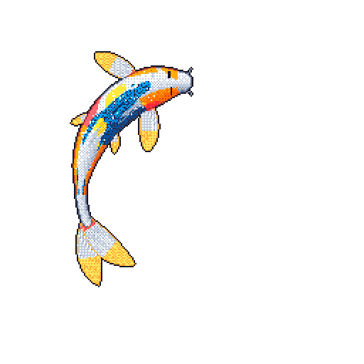

   <samp> 
   Software Engineer at <a href="https://www.infopercept.com">Infopercept Consulting</a> 
   Specializing in Cybersecurity Development 
   Skilled in Bash, Rust, Go & Yara 
    
   </samp>

   <samp>
   <a href="https://github.com/mranv">GitHub</a>
   ·
   <a href="https://www.linkedin.com/in/anubhavgain/">LinkedIn</a>
   ·
   <a href="mailto:iamanubhavgain@gmail.com">Email</a>
   </samp>

  

  <!-- Streak stats (github-readme-activity-graph.vercel.app is offline: 402 DEPLOYMENT_DISABLED) -->
  

   <samp>——— Securing Digital Infrastructure ———</samp>

